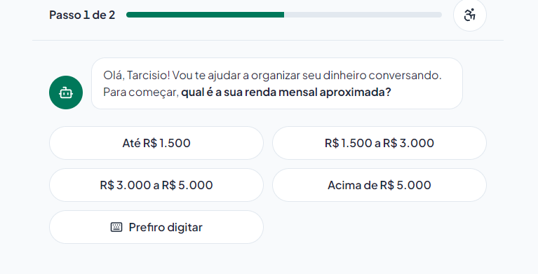
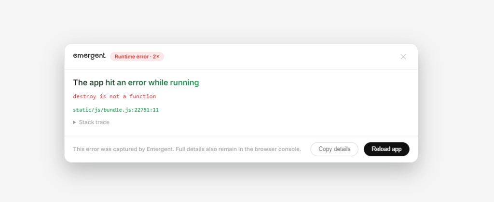

# Uma Breve Reflexão sobre o Processo

> **Desafio DIO: Vibe Coding com IA — Criando um App de Finanças Pessoais**  
> *Autor: Tarcisio Bispo de Araujo*  
> *Ambiente de Execução: Emergent Agentic Platform + Antigravity*

---

## 1. O que funcionou bem?

* **O poder do PRD Estruturado (Snippet de Briefing):**
  A inclusão prévia de um PRD rico em detalhes e restrições (personas, WCAG 2.2 AA, métricas e telas) transformou a conversa com a IA. O agente autônomo (no Emergent) não "alucinou" soluções genéricas; em vez disso, atuou como um co-piloto técnico que entrevistou o criador com perguntas arquiteturais maduras:
  - *Modelo de IA:* Gemini 3 Flash (rápido e econômico);
  - *Autenticação:* Login com Google em 1 clique;
  - *Entrada de voz:* Web Speech API nativa do navegador (gratuita e sem dependência de chaves de API);
  - *Backend & Persistência:* Adaptação do modelo para FastAPI + MongoDB com sincronização ao vivo;
  - *Diretriz de síntese:* A instrução *"Não complique"* foi perfeitamente respeitada na escolha da arquitetura.

* **Fidelidade Visual e Empatia no Onboarding:**
  A IA gerou a interface da Landing Page e o fluxo de entrada com precisão impressionante em relação às especificações de design universal e heurísticas de Nielsen:
  - Landing Page completa com proposta de valor, pílulas de atalho, modo acessível e simulação do cartão de transação;
  - Onboarding personalizado (*"Olá, Tarcisio!"*) com indicador de progresso (*Passo 1 de 2*), botões amplos para faixas de renda e alternativa *"Prefiro digitar"*.

### Evidências do que funcionou:

| Landing Page Gerada | Onboarding Conversacional (Passo 1) |
| :---: | :---: |
|  |  |

---

## 2. O que não funcionou como o esperado?

* **Bug de Execução em Runtime no Frontend (`destroy is not a function`):**
  Apesar de a estrutura de pastas e componentes ter sido criada com sucesso (`server.py`, `AuthCallback.jsx`, `useVoice.js`, `index.css`), o aplicativo travou em tempo de execução ao rodar no navegador. O console disparou o erro clássico de React: `destroy is not a function` (em `bundle.js:22751`). Isso ocorre quando um hook de ciclo de vida (`useEffect`) — muito provavelmente dentro do gerenciador de áudio/reconhecimento de voz `useVoice.js` — retorna uma Promise ou objeto inválido em vez de uma função síncrona de limpeza (*cleanup*).

* **Gargalo de Créditos antes do Ciclo de Correção (Debug):**
  Plataformas de Vibe Coding com agentes autônomos que realizam scaffolding completo (backend + frontend + rotas) realizam muitas chamadas consecutivas de LLM. Os créditos da sessão gratuita se esgotaram antes que fosse possível submeter o erro de volta ao agente para correção cirúrgica do bug e finalização do deploy.

### Registro do erro de runtime:

---

## 3. O que aprendeu sobre conversar com IAs?

1. **A qualidade do briefing determina o nível da entrega:**  
   Quanto mais claro, delimitado e contextualizado for o documento de partida (o PRD), menos a IA divaga. O agente se apoia nas restrições fornecidas para tomar decisões consistentes de design e stack.
2. **Construção em fatias finas (*Thin Vertical Slices*):**  
   Pedir a aplicação inteira de uma vez consome créditos rapidamente e acumula pontos cegos de falha. O caminho mais eficiente no Vibe Coding é a iteração modular: primeiro a casca visual da UI, depois o estado do chat, depois o hook de voz e, por fim, a persistência no banco de dados.
3. **O humano atua como Diretor Técnico e Revisor de Qualidade:**  
   Vibe Coding não elimina a necessidade de raciocínio lógico e conhecimento de engenharia. A IA acelera a escrita de código em 10x, mas cabe ao desenvolvedor interpretar o stack trace, identificar que `destroy is not a function` se refere ao cleanup de um `useEffect` e guiar a correção.
4. **Comandos de restrição são tão vitais quanto descrições longas:**  
   Instruções curtas como *"Não complique"* evitam over-engineering e impedem que a IA adicione bibliotecas pesadas e desnecessárias ao projeto.
